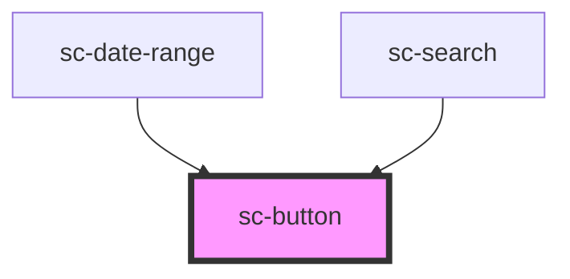

# sc-button

Starts an action. If it goes somewhere instead, use `sc-link` (or `sc-button href` for a call to action that must look like a button, such as "Start now").

## Usage

```html
<sc-button type="submit" icon="arrow-forward">Continue</sc-button>
<sc-button variant="secondary">Save and finish later</sc-button>
<sc-button href="/renew/start" icon="arrow-forward">Start now</sc-button>
```

### Which variant

| Variant | Use it for | Example |
|---|---|---|
| `primary` | The one main action on the page. Never more than one per page or section. | "Continue", "Pay with Dubai Pay" |
| `secondary` | Other actions next to a primary one, or the main action when it isn't the way forward. | "Save and finish later", "Change" |
| `tertiary` | Low-emphasis actions that would compete with the primary if they had a fill. | "Cancel", "View all services" |
| `destructive` | An action that deletes data or can't be undone. Confirm it on the next screen. | "Delete draft", "Cancel renewal" |
| `handoff` | A shared government hand-off. City indigo on every channel, so it never looks like the channel's own action (U3). | "Sign in with UAE PASS", "Pay with Dubai Pay" |

- Heights follow the variant: 56px for `primary`, `destructive` and `handoff`; 48px for `secondary` and `tertiary`. Set `size="l"` (56px) or `size="m"` (48px) to override; `size="xl"` (64px) is for the hero search only.
- Use `full-width` on narrow screens when the button ends a form.
- Put the primary button first in the reading order. In Arabic it sits on the right automatically.

### Content

- Start with a verb and say what happens: "Continue", "Pay with Dubai Pay", "Save and finish later". Not "Submit", "OK" or "Click here".
- Sentence case, no full stop, as short as it can be while staying specific. Write the Arabic label, don't machine-translate it.
- Use the `arrow-forward` icon at the end only for actions that move the user forward in a journey. It mirrors in Arabic. Don't add icons for decoration.
- Amounts and references inside a label stay left-to-right: `<sc-button>Pay <sc-ltr>AED 450.00</sc-ltr></sc-button>`.

### States

- **Loading:** set `loading` while the action runs (for example, while a payment starts). The button keeps its width, shows a spinner, sets `aria-busy`, announces "Pay with Dubai Pay, Loading" (or the Arabic equivalent) and ignores clicks. Remove `loading` when the action ends.
- **Disabled:** supported, but avoid it. A disabled button can't be focused and gives no reason, so many users can't tell why they're stuck. Leave it enabled and show an error message (and `sc-error-summary`) when the user tries to continue.

### Forms

`sc-button` renders a native `<button>` (or `<a>`) in light DOM (v2, decision A2), so it is a real form control:

- `type="submit"` submits the surrounding `<form>`, and the first submit button is the form's **default button**: Enter in any field submits through it. `name`, `value` and `form="<form id>"` work as on a native button. `type="reset"` resets the form. The default `type` is `button`, unlike the native element.
- A `<fieldset disabled>` disables it natively.
- `focus()` and `click()` on the host reach the native control.
- There is no `::part()` in v2. Style overrides, if you must, target `.sc-button`, `.sc-button__label` and `.sc-button__icon`; the component's rules are in `@layer sc.components`, so your unlayered CSS wins.
- Frameworks that own children (React) must not re-render the label text after upgrade: Stencil moves it into the native button.

<!-- Auto Generated Below -->


## Overview

Starts an action. Use a verb: "Continue", "Pay with Dubai Pay", "Save and finish later".

v2 renders a native `<button>` (or an `<a>` when `href` is set) in light DOM (Stencil
`scoped`, decision A2). The button is a real form control: Enter in a field submits the
form through the first `type="submit"` button (it is the form's default button), and
`name`, `value`, `form` and a disabled `<fieldset>` all work natively. `focus()` and
`click()` on the host reach the inner control. There is no `::part()`: if you must style
it, use the classes `.sc-button`, `.sc-button__label` and `.sc-button__icon`.

## Properties

| Property       | Attribute       | Description                                                                                                                                                                                                                                                                                                                                                                                                                                                                                             | Type                                                                                                                                                                               | Default     |
| -------------- | --------------- | ------------------------------------------------------------------------------------------------------------------------------------------------------------------------------------------------------------------------------------------------------------------------------------------------------------------------------------------------------------------------------------------------------------------------------------------------------------------------------------------------------- | ---------------------------------------------------------------------------------------------------------------------------------------------------------------------------------- | ----------- |
| `disabled`     | `disabled`      | Prevents interaction. Avoid it (A11Y-08): a disabled button gives no reason and can't be focused. Leave the button enabled and explain the problem with an error message instead.                                                                                                                                                                                                                                                                                                                       | `boolean`                                                                                                                                                                          | `false`     |
| `formId`       | `form`          | The id of the `<form>` this button belongs to when it sits outside it (the native `form` attribute).                                                                                                                                                                                                                                                                                                                                                                                                    | `string \| undefined`                                                                                                                                                              | `undefined` |
| `fullWidth`    | `full-width`    | Stretches the button to the width of its container. Use it on narrow screens.                                                                                                                                                                                                                                                                                                                                                                                                                           | `boolean`                                                                                                                                                                          | `false`     |
| `href`         | `href`          | Renders a link (`<a href>`) styled as a button. Use it when the action goes to another page.                                                                                                                                                                                                                                                                                                                                                                                                            | `string \| undefined`                                                                                                                                                              | `undefined` |
| `icon`         | `icon`          | An icon from the library (`src/icons`), e.g. `arrow-forward`. Arrows and chevrons mirror in right-to-left.                                                                                                                                                                                                                                                                                                                                                                                              | `"alert-circle" \| "arrow-forward" \| "check-circle" \| "chevron-back" \| "chevron-forward" \| "close" \| "external" \| "info" \| "search" \| "spinner" \| "warning" \| undefined` | `undefined` |
| `iconPosition` | `icon-position` | Where the icon sits relative to the label.                                                                                                                                                                                                                                                                                                                                                                                                                                                              | `"end" \| "start"`                                                                                                                                                                 | `'end'`     |
| `loading`      | `loading`       | Shows a spinner while an action is in progress. The button keeps its width and focus, sets `aria-busy`, announces "Loading" and ignores activation (no click handlers, no submit) until `loading` is removed.                                                                                                                                                                                                                                                                                           | `boolean`                                                                                                                                                                          | `false`     |
| `loadingText`  | `loading-text`  | Overrides the visually hidden "Loading" text (default from strings, in the page language).                                                                                                                                                                                                                                                                                                                                                                                                              | `string \| undefined`                                                                                                                                                              | `undefined` |
| `name`         | `name`          | Submitted with the form as `name=value` when this button submits it.                                                                                                                                                                                                                                                                                                                                                                                                                                    | `string \| undefined`                                                                                                                                                              | `undefined` |
| `size`         | `size`          | Height. Leave it unset for the variant's own height (56px for primary, destructive and handoff; 48px for secondary and tertiary). `l` is 56px, `m` 48px (compact layouts, tables, headers), `xl` 64px (the hero search only).                                                                                                                                                                                                                                                                           | `"l" \| "m" \| "xl" \| undefined`                                                                                                                                                  | `undefined` |
| `type`         | `type`          | What the button does in a form. `submit` submits the surrounding `<form>` natively, so validation and `submit` listeners run, and the first submit button is the form's default button for Enter in a field. `reset` resets it. Defaults to `button`, unlike the native element, so a button never submits by accident. Ignored when `href` is set.                                                                                                                                                     | `"button" \| "reset" \| "submit"`                                                                                                                                                  | `'button'`  |
| `value`        | `value`         | The value submitted with `name`.                                                                                                                                                                                                                                                                                                                                                                                                                                                                        | `string \| undefined`                                                                                                                                                              | `undefined` |
| `variant`      | `variant`       | Visual weight. - `primary`: the one main action on a page (channel action fill). 56px. - `secondary`: other actions beside a primary one (outlined in the channel colour). 48px. - `tertiary`: low-emphasis actions, styled as an underlined link. 48px. - `destructive`: deletes or cancels something that can't be undone (error fill). 56px. - `handoff`: a shared government hand-off, such as "Sign in with UAE PASS" or "Pay with   Dubai Pay": city indigo on every channel (decision U3). 56px. | `"destructive" \| "handoff" \| "primary" \| "secondary" \| "tertiary"`                                                                                                             | `'primary'` |


## Slots

| Slot     | Description                                                                                                                                                                                               |
| -------- | --------------------------------------------------------------------------------------------------------------------------------------------------------------------------------------------------------- |
|          | The label. Text only; keep it short and start with a verb.                                                                                                                                                |
| `"icon"` | Optional custom icon (an inline `<svg slot="icon">`), used instead of the `icon` prop, e.g. provider artwork on a hand-off. Add `data-directional` to an arrow or chevron so it mirrors in right-to-left. |


## Dependencies

### Used by

 - [sc-date-range](../sc-date-range)
 - [sc-search](../sc-search)

### Graph


----------------------------------------------


