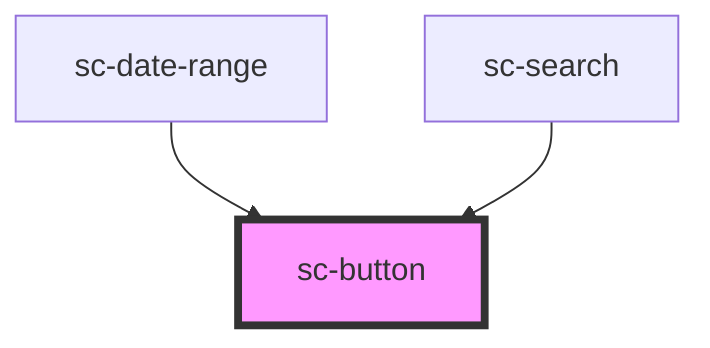

# sc-button

Starts an action. If it goes somewhere instead, use `sc-link` (or `sc-button href` for a call to action that must look like a button, such as "Start now").

## Usage

```html
<sc-button type="submit" icon="arrow-forward">Continue</sc-button>
<sc-button variant="secondary">Save and finish later</sc-button>
<sc-button href="/renew/start" icon="arrow-forward">Start now</sc-button>
```

### Which variant

| Variant | Use it for | Example |
|---|---|---|
| `primary` | The one main action on the page. Never more than one per page or section. | "Continue", "Pay with Dubai Pay" |
| `secondary` | Other actions next to a primary one, or the main action when it isn't the way forward. | "Save and finish later", "Change" |
| `tertiary` | Low-emphasis actions that would compete with the primary if they had a fill. | "Cancel", "View all services" |
| `destructive` | An action that deletes data or can't be undone. Confirm it on the next screen. | "Delete draft", "Cancel renewal" |

- `size="l"` (54px) is the default and the size for primary actions. Use `size="m"` (44px) only in dense layouts such as tables and summary lists.
- Use `full-width` on narrow screens when the button ends a form.
- Put the primary button first in the reading order. In Arabic it sits on the right automatically.

### Content

- Start with a verb and say what happens: "Continue", "Pay with Dubai Pay", "Save and finish later". Not "Submit", "OK" or "Click here".
- Sentence case, no full stop, as short as it can be while staying specific. Write the Arabic label, don't machine-translate it.
- Use the `arrow-forward` icon at the end only for actions that move the user forward in a journey. It mirrors in Arabic. Don't add icons for decoration.
- Amounts and references inside a label stay left-to-right: `<sc-button>Pay <sc-ltr>AED 450.00</sc-ltr></sc-button>`.

### States

- **Loading:** set `loading` while the action runs (for example, while a payment starts). The button keeps its width, shows a spinner, sets `aria-busy`, announces "Pay with Dubai Pay, Loading" (or the Arabic equivalent) and ignores clicks. Remove `loading` when the action ends.
- **Disabled:** supported, but avoid it. A disabled button can't be focused and gives no reason, so many users can't tell why they're stuck. Leave it enabled and show an error message (and `sc-error-summary`) when the user tries to continue.

### Forms

`sc-button` is form-associated. `type="submit"` submits the surrounding `<form>` with `form.requestSubmit()`, so native validation and `submit` listeners run; `type="reset"` resets it. The default `type` is `button`, unlike the native element. A `<fieldset disabled>` disables it like a native button.

Known limits of form-associated custom elements: the button isn't the form's `submitter` (`event.submitter` is `null`, and it submits no `name`/`value`), and it doesn't count as the form's default button for implicit submission (pressing Enter in a field submits only when the form has a single text field, or a native submit button).

### Styling hooks

Parts: `control` (the inner `<button>` or `<a>`), `label`, `icon`. Colours come from the page's channel (`data-channel`) and theme; don't override them per button.

<!-- Auto Generated Below -->


## Overview

Starts an action. Use a verb: "Continue", "Pay with Dubai Pay", "Save and finish later".

Renders a native `<button>` (or an `<a>` when `href` is set) inside its shadow root.
The host is form-associated, so `type="submit"` and `type="reset"` work with the
surrounding `<form>`, and it delegates focus to the inner control.

## Properties

| Property       | Attribute       | Description                                                                                                                                                                                                                                                                                                   | Type                                                                                                                                                                               | Default     |
| -------------- | --------------- | ------------------------------------------------------------------------------------------------------------------------------------------------------------------------------------------------------------------------------------------------------------------------------------------------------------- | ---------------------------------------------------------------------------------------------------------------------------------------------------------------------------------- | ----------- |
| `disabled`     | `disabled`      | Prevents interaction. Avoid it: a disabled button gives no reason and can't be focused, so many users can't tell why they're stuck. Leave the button enabled and explain the problem with an error message instead.                                                                                           | `boolean`                                                                                                                                                                          | `false`     |
| `fullWidth`    | `full-width`    | Stretches the button to the width of its container. Use it on narrow screens.                                                                                                                                                                                                                                 | `boolean`                                                                                                                                                                          | `false`     |
| `href`         | `href`          | Renders a link (`<a href>`) styled as a button. Use it when the action goes to another page.                                                                                                                                                                                                                  | `string \| undefined`                                                                                                                                                              | `undefined` |
| `icon`         | `icon`          | An icon from the library (`src/icons`), e.g. `arrow-forward`. Arrows and chevrons mirror in right-to-left.                                                                                                                                                                                                    | `"alert-circle" \| "arrow-forward" \| "check-circle" \| "chevron-back" \| "chevron-forward" \| "close" \| "external" \| "info" \| "search" \| "spinner" \| "warning" \| undefined` | `undefined` |
| `iconPosition` | `icon-position` | Where the icon sits relative to the label.                                                                                                                                                                                                                                                                    | `"end" \| "start"`                                                                                                                                                                 | `'end'`     |
| `loading`      | `loading`       | Shows a spinner while an action is in progress. The button keeps its width, sets `aria-busy`, announces "Loading" and ignores clicks until `loading` is removed.                                                                                                                                              | `boolean`                                                                                                                                                                          | `false`     |
| `loadingText`  | `loading-text`  | Overrides the visually hidden "Loading" text (default from strings, in the page language).                                                                                                                                                                                                                    | `string \| undefined`                                                                                                                                                              | `undefined` |
| `size`         | `size`          | Height: `l` is 54px (default, for primary actions), `m` is 44px (dense layouts).                                                                                                                                                                                                                              | `"l" \| "m"`                                                                                                                                                                       | `'l'`       |
| `type`         | `type`          | What the button does in a form. `submit` submits the surrounding `<form>` (through `form.requestSubmit()`, so validation and `submit` listeners run); `reset` resets it. Defaults to `button`, unlike the native element, so a button never submits by accident. Ignored when `href` is set.                  | `"button" \| "reset" \| "submit"`                                                                                                                                                  | `'button'`  |
| `variant`      | `variant`       | Visual weight. - `primary`: the one main action on a page (channel action fill). - `secondary`: other actions next to a primary one (channel subtle fill). - `tertiary`: low-emphasis actions (no fill, underline on hover). - `destructive`: deletes or cancels something that can't be undone (error fill). | `"destructive" \| "primary" \| "secondary" \| "tertiary"`                                                                                                                          | `'primary'` |


## Slots

| Slot     | Description                                                                                                                                              |
| -------- | -------------------------------------------------------------------------------------------------------------------------------------------------------- |
|          | The button label. Text only; keep it short and start with a verb.                                                                                        |
| `"icon"` | Optional custom icon (an inline `<svg>`), used instead of the `icon` prop. Add `data-directional` to an arrow or chevron so it mirrors in right-to-left. |


## Shadow Parts

| Part        | Description                          |
| ----------- | ------------------------------------ |
| `"control"` | The inner `<button>` or `<a>`.       |
| `"icon"`    | The wrapper around the icon.         |
| `"label"`   | The wrapper around the default slot. |


## Dependencies

### Used by

 - [sc-date-range](../sc-date-range)
 - [sc-search](../sc-search)

### Graph


----------------------------------------------


