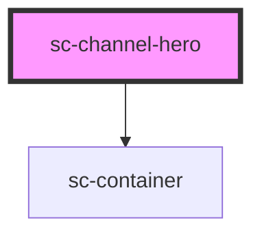

# sc-channel-hero

The top of a channel's home or section page: a wash in the channel's colours, the page heading and usually search.

## Usage

```html
<sc-channel-hero>
  <p slot="eyebrow">Government services for everyone who lives in Dubai</p>
  <h1 slot="heading">What do you need to do?</h1>
  <sc-search label-hidden label="Search services" placeholder="Try “renew car registration” or “school fees”" action="/search"></sc-search>
</sc-channel-hero>
```

- Pass the page's `<h1>` in the `heading` slot. The hero styles it (heading-xl on phones, display-l from 1024px) but it stays a real heading.
- The eyebrow is optional context, one short line. The lede (`slot="lede"`) is one or two sentences; skip it on a home page whose heading is a question.
- The default slot holds search and anything that goes with it, such as "Popular now" links.
- One hero per page, at the top of `<main>`. Don't put calls to action in the hero other than search.

### Colour

The wash is `linear-gradient(in oklab, var(--sc-channel-wash-start), var(--sc-channel-wash-end))`, so it follows `data-channel` and the theme. In forced colours it becomes plain canvas with a rule underneath.

### Layout

The hero is full-bleed; its content sits in an `sc-container`, so it lines up with the page below, and is capped at eight of twelve columns.

### Arabic

Content aligns right; the search field mirrors.

<!-- Auto Generated Below -->


## Overview

The top wash of a channel page: a gradient from the channel's wash-start to wash-end
colour (interpolated in OKLAB), holding an eyebrow, the page's `<h1>`, a lede and a
search field. It follows `data-channel` and the theme like every component.

The hero is full-bleed; its content sits in an `sc-container`, so it lines up with the
page below.

## Slots

| Slot        | Description                                                                                    |
| ----------- | ---------------------------------------------------------------------------------------------- |
|             | Search (`sc-search`) and anything that goes with it, such as popular links.                    |
| `"eyebrow"` | A short line above the heading, e.g. "Government services for everyone who lives in Dubai".    |
| `"heading"` | The page's `<h1>`. Pass the element itself: `<h1 slot="heading">What do you need to do?</h1>`. |
| `"lede"`    | An optional paragraph under the heading.                                                       |


## Shadow Parts

| Part        | Description                   |
| ----------- | ----------------------------- |
| `"content"` | The column holding the slots. |
| `"wash"`    | The full-bleed gradient.      |


## Dependencies

### Depends on

- [sc-container](../sc-container)

### Graph


----------------------------------------------


