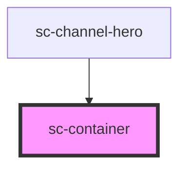

# sc-container

Centres content and sets the page's outer margins from the layout tokens.

## Usage

```html
<sc-container>
  <h2>Most used services</h2>
  <sc-grid span-medium="4" span-expanded="4">…</sc-grid>
</sc-container>

<sc-container width="reading">
  <h1>Check your answers before you pay</h1>
  <sc-summary-list>…</sc-summary-list>
</sc-container>
```

| Window | Margin | Token |
|---|---|---|
| under 600px | 20px | `--sc-grid-compact-margin` |
| 600px | 32px | `--sc-grid-medium-margin` |
| 1024px | 48px | `--sc-grid-expanded-margin` |
| 1440px | 80px | `--sc-grid-wide-margin` |

- Content is capped at `--sc-container-max` (1280px) and centred beyond that.
- `width="reading"` caps the column at `--sc-container-reading` (680px) and keeps it at the start edge, aligned with headings and back links. Use it for question pages, "Check your answers" and running text.
- Full-bleed sections (a hero, a coloured band) go outside the container and put one inside.

### Breakpoints

Media queries can't read custom properties, so the breakpoint widths (600, 1024, 1440px from `tokens/layout.json`) are repeated in the CSS with a comment; the margins themselves are tokens. Margins follow the window, not the parent.

### Arabic

The reading column starts at the right.

<!-- Auto Generated Below -->


## Overview

Centres content and sets the page's outer margins from the layout tokens: 20px on
phones, 32px from 600px, 48px from 1024px and 80px from 1440px, with content capped at
`--sc-container-max` (1280px). `width="reading"` caps it at the 680px reading width instead,
for question pages and running text.

## Properties

| Property | Attribute | Description                                                                                                               | Type                  | Default  |
| -------- | --------- | ------------------------------------------------------------------------------------------------------------------------- | --------------------- | -------- |
| `width`  | `width`   | `page` (default) caps content at 1280px; `reading` caps it at 680px and keeps it at the start, aligned with page content. | `"page" \| "reading"` | `'page'` |


## Slots

| Slot | Description       |
| ---- | ----------------- |
|      | The page content. |


## Shadow Parts

| Part      | Description                                  |
| --------- | -------------------------------------------- |
| `"inner"` | The width-capped wrapper inside the margins. |


## Dependencies

### Used by

 - [sc-channel-hero](../sc-channel-hero)

### Graph


----------------------------------------------


