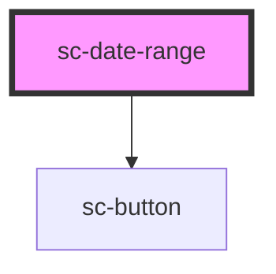

# sc-date-range

A start and an end date that relate to a calendar: filtering payments or fines between two dates, the nights of a stay on Visit Dubai, how long a permit lasts. For a single date people already know (a date of birth, a policy start date), use `sc-date-input`: people type those faster than they find them in a calendar.

## Usage

```html
<sc-date-range
  name="payments"
  label="Show payments between"
  hint="For example, 21 9 2026"
  start="2026-09-21"
  end="2026-10-09"
  max="2026-10-19"
  max-days="365"
  presets
></sc-date-range>
```

- **Field:** a `<fieldset>` and `<legend>`, the hint, then one 56px frame with two typed segments, From and To (من / إلى), an arrow between them (→, ← in Arabic) and a calendar button at inline-end. People can always type: "21/9/2026", "21 9 2026" and "21-09-2026" all work, and each segment is formatted on blur ("21 Sep 2026").
- **Picker:** the calendar button opens a popover on medium and wider screens: one or two months (`months`, `auto` shows two from 720px), always 6 weeks, Monday first, and optional presets at inline-start. The first click sets the start, the second the end; a day before the start, or any day after a complete range, starts again. Apply writes both dates, closes the picker and returns focus to the button; Escape or a click outside closes without changes. Below 600px it is a modal bottom sheet with From / To chips, preset chips and a scrolling list of months; it can be dragged down to close. The weekday row and the footer sit outside the scrolling list, so a focused day is never covered, and at 320px the calendar padding shrinks so seven 44px days fit without sideways scrolling. The previous and next month buttons are 44px targets around 36px circles.
- **Presets:** `presets` shows Today, Last 7 days, Last 30 days, This month, Last month and This year (clamped to `min` / `max`). Pass a JSON list to replace them, for a booking calendar: `[{"label": "This weekend", "start": "2026-10-24", "end": "2026-10-25"}]`. A preset applies at once and doesn't close the picker.
- **Limits:** `min` and `max` disable days outside them (for payment filters, `max` is today); `min-days` and `max-days` disable days that would make the range too short or too long once a start is chosen, and the footer says "You can choose up to 90 days".
- **Keyboard** (ARIA APG date picker): arrows move a day and move visually, so in Arabic Left is the next day; Up and Down move a week; Home and End go to the start and end of the week; Page Up / Page Down change the month and Shift with them the year; Enter or Space chooses the day. Keyboard month changes are instant; pointer ones crossfade. Opened from the keyboard, the popover appears instantly (MOT-02); opened with a pointer it scales in.
- **Errors:** set `error` and `error-parts` (`start`, `end` or `both`) as on the other fields. The component also shows its own message on blur for an impossible range (end before start, a date that isn't real, outside `min`/`max`, too long or too short) and never swaps the dates; "Enter a start date" and "Enter an end date" wait for a submit.
- **Forms:** submits `name-start` and `name-end` as ISO dates (empty until each is a real date) and resets to the initial range. Validity: `valueMissing` (with `required`, or a half-filled range), `badInput`, `rangeUnderflow`, `rangeOverflow`. `scChange` carries `{ start, end }`; `scOpen` and `scClose` fire with the picker. Methods: `open()`, `close()`, `setFocus()`.
- **Today:** the `today` property fixes "today" (ISO) when the server's date matters, and in tests.
- **Arabic:** the whole component mirrors: From is on the right, Monday is the rightmost column, the previous-month button is on the right and presets sit on the right. Month and weekday names are Arabic, digits stay Latin. Gregorian only for now.

<!-- Auto Generated Below -->


## Overview

A start and an end date that relate to a calendar: filtering payments between two dates,
the nights of a hotel stay, how long a permit lasts. For one date people already know
(a date of birth), use `sc-date-input`.

Two typed segments (From / To, من / إلى) in one 56px frame, and a calendar button that
opens a picker: a popover with one or two months and optional presets on medium and
wider screens, a modal bottom sheet below 600px. People can always type instead
("21/9/2026", "21 9 2026", "21-09-2026").

v2 renders everything in light DOM (Stencil `scoped`, decision A2), with classes prefixed
`.sc-date-range__`. It submits `name-start` and `name-end` as ISO dates through hidden
inputs (empty until each is a real date). The first problem with the range (missing with
`required`, not a real date, end before start, outside `min`/`max`, too long or short) is a
native validity error on the segment concerned; the component shows its own message on
blur or after a failed submit. `focus()` on the host goes to the start segment. One native
`change` is dispatched from the host per committed range.

Rich content: a child with `slot="label"`, `slot="hint"` or `slot="error"` is moved into place once.

## Properties

| Property       | Attribute       | Description                                                                                                                                                                                                                                                    | Type                                      | Default     |
| -------------- | --------------- | -------------------------------------------------------------------------------------------------------------------------------------------------------------------------------------------------------------------------------------------------------------- | ----------------------------------------- | ----------- |
| `disabled`     | `disabled`      | Disables the field. Avoid it.                                                                                                                                                                                                                                  | `boolean`                                 | `false`     |
| `end`          | `end`           | The end date, ISO (`2026-10-09`). Empty until it is a real date.                                                                                                                                                                                               | `string`                                  | `''`        |
| `error`        | `error`         | The error message. Setting it shows the error state (it replaces the component's own messages).                                                                                                                                                                | `string \| undefined`                     | `undefined` |
| `errorParts`   | `error-parts`   | Which segment the error marks: `start`, `end` or `both`.                                                                                                                                                                                                       | `"both" \| "end" \| "start"`              | `'both'`    |
| `headingLevel` | `heading-level` | When set (1–6), the legend is also the page heading at this level.                                                                                                                                                                                             | `1 \| 2 \| 3 \| 4 \| 5 \| 6 \| undefined` | `undefined` |
| `hint`         | `hint`          | An example in the typed order: "For example, 21 9 2026".                                                                                                                                                                                                       | `string \| undefined`                     | `undefined` |
| `label`        | `label`         | The question, shown as the legend: "Show payments between".                                                                                                                                                                                                    | `string \| undefined`                     | `undefined` |
| `max`          | `max`           | The latest day people can choose, ISO. For payment filters this is today.                                                                                                                                                                                      | `string \| undefined`                     | `undefined` |
| `maxDays`      | `max-days`      | The longest range, in days, counted inclusively. Days past the limit are disabled once a start is chosen.                                                                                                                                                      | `number \| undefined`                     | `undefined` |
| `min`          | `min`           | The earliest day people can choose, ISO.                                                                                                                                                                                                                       | `string \| undefined`                     | `undefined` |
| `minDays`      | `min-days`      | The shortest range, in days, counted inclusively.                                                                                                                                                                                                              | `number \| undefined`                     | `undefined` |
| `months`       | `months`        | Months shown in the popover: `1`, `2`, or `auto` (two when the window is at least 720px wide).                                                                                                                                                                 | `"auto" \| 1 \| 2`                        | `'auto'`    |
| `name`         | `name`          | The name submitted with the form, as `name-start` and `name-end`.                                                                                                                                                                                              | `string \| undefined`                     | `undefined` |
| `optional`     | `optional`      | Appends "(optional)" to the legend.                                                                                                                                                                                                                            | `boolean`                                 | `false`     |
| `presets`      | `presets`       | Quick ranges at inline-start of the picker. `true` (or the bare attribute) shows Today, Last 7 days, Last 30 days, This month, Last month and This year. A JSON list replaces them: `[{"label": "This weekend", "start": "2026-10-23", "end": "2026-10-24"}]`. | `boolean \| string`                       | `false`     |
| `required`     | `required`      | Requires both dates (`valueMissing` while either is empty).                                                                                                                                                                                                    | `boolean`                                 | `false`     |
| `start`        | `start`         | The start date, ISO (`2026-09-21`). Empty until it is a real date.                                                                                                                                                                                             | `string`                                  | `''`        |
| `strings`      | `strings`       | Overrides the built-in English and Arabic strings, as JSON (`{"dateRangeFrom": "Check-in"}`, or per language `{"ar": {…}}`).                                                                                                                                   | `null \| string \| undefined \| unknown`  | `undefined` |
| `today`        | `today`         | Today's date, ISO. Defaults to the browser's date; set it when the server's "today" matters, and in tests.                                                                                                                                                     | `string \| undefined`                     | `undefined` |


## Events

| Event      | Description                                                                                                                               | Type                                           |
| ---------- | ----------------------------------------------------------------------------------------------------------------------------------------- | ---------------------------------------------- |
| `scChange` | Fires when the range changes (Apply, or a committed typed date), with `{ start, end }`. A native `change` is also dispatched on the host. | `CustomEvent<{ start: string; end: string; }>` |
| `scClose`  | Fires when the picker closes.                                                                                                             | `CustomEvent<void>`                            |
| `scOpen`   | Fires when the picker opens.                                                                                                              | `CustomEvent<void>`                            |


## Methods

### `close() => Promise<void>`

Closes the picker without changing the field.

#### Returns

Type: `Promise<void>`


### `open() => Promise<void>`

Opens the picker.

#### Returns

Type: `Promise<void>`


### `setFocus() => Promise<void>`

Focuses the start segment.

#### Returns

Type: `Promise<void>`


## Dependencies

### Depends on

- [sc-button](../sc-button)

### Graph


----------------------------------------------


