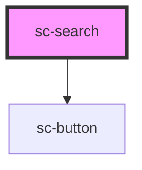

# sc-search

A search box for a channel or a list of services.

## Usage

```html
<sc-search label="Search Dubai Now services" placeholder="Try “renew car registration” or “school fees”" action="/search"></sc-search>
```

```js
document.querySelector('sc-search').addEventListener('scSearch', (ev) => {
  ev.preventDefault();            // handle it in the page instead of going to `action`
  showResults(ev.detail.value);
});
```

- Give it a specific `label` ("Search Dubai Now services"). Hide it visually with `label-hidden` only where the context makes the purpose obvious, such as a hero that asks "What do you need to do?"; screen readers still read it.
- `placeholder` gives example queries. It disappears when typing, so never put instructions there.
- With `action`, submitting goes to that URL with `?q=…` (`name` changes the parameter) after `scSearch`, unless a listener cancels the event. Without `action`, handle `scSearch`.
- The button text defaults to "Search" ("بحث"); change it with `button-text` only for a more specific verb.

### Behaviour

The component renders `<form role="search">` named by the label, a native `<input type="search">` and a primary `sc-button type="submit"`. Enter in the field and the button both submit; `scSearch` carries the trimmed query. Focus on the host goes to the input (`delegatesFocus`), and the focus ring wraps the whole pill. The form is self-contained: don't put `sc-search` inside another `<form>`.

### Arabic

The field mirrors: icon on the right, button on the left. The default label and button read "بحث". Search terms are typed in either script; the field follows the page direction.

<!-- Auto Generated Below -->


## Overview

A pill search box: search icon, a labelled field and a primary "Search" button, inside a
`<form role="search">` (a search landmark named by the label).

Submitting (the button, or Enter in the field) emits `scSearch`. With `action`, the form
then goes to that URL with the query as `?<name>=…`, unless a listener calls
`preventDefault()`; without `action`, the page handles `scSearch` itself.

The form is self-contained: don't nest `sc-search` inside another `<form>`.

## Properties

| Property      | Attribute      | Description                                                                                                                                                                   | Type                  | Default     |
| ------------- | -------------- | ----------------------------------------------------------------------------------------------------------------------------------------------------------------------------- | --------------------- | ----------- |
| `action`      | `action`       | The results page. When set, the form submits there with GET after `scSearch`, unless the event is cancelled.                                                                  | `string \| undefined` | `undefined` |
| `buttonText`  | `button-text`  | The button text. Defaults to "Search" ("بحث").                                                                                                                                | `string \| undefined` | `undefined` |
| `label`       | `label`        | The field's label. Defaults to "Search" ("بحث"). Make it specific: "Search Dubai Now services".                                                                               | `string \| undefined` | `undefined` |
| `labelHidden` | `label-hidden` | Hides the label visually; screen readers still read it. Only do this when the context makes the purpose obvious, such as a hero whose heading asks "What do you need to do?". | `boolean`             | `false`     |
| `name`        | `name`         | The query parameter name sent with `action`.                                                                                                                                  | `string`              | `'q'`       |
| `placeholder` | `placeholder`  | Example queries, e.g. `Try "renew car registration"`. A hint, never a replacement for the label.                                                                              | `string \| undefined` | `undefined` |
| `value`       | `value`        | The query. Updated as the user types.                                                                                                                                         | `string`              | `''`        |


## Events

| Event      | Description                                                                                            | Type                          |
| ---------- | ------------------------------------------------------------------------------------------------------ | ----------------------------- |
| `scSearch` | Emitted on submit with the trimmed query. Cancelable: `preventDefault()` stops navigation to `action`. | `CustomEvent<ScSearchDetail>` |


## Methods

### `setFocus() => Promise<void>`

Focuses the input.

#### Returns

Type: `Promise<void>`


## Shadow Parts

| Part      | Description                                 |
| --------- | ------------------------------------------- |
| `"field"` | The pill around the icon, input and button. |
| `"input"` | The native `<input type="search">`.         |
| `"label"` | The `<label>`.                              |


## Dependencies

### Depends on

- [sc-button](../sc-button)

### Graph


----------------------------------------------


